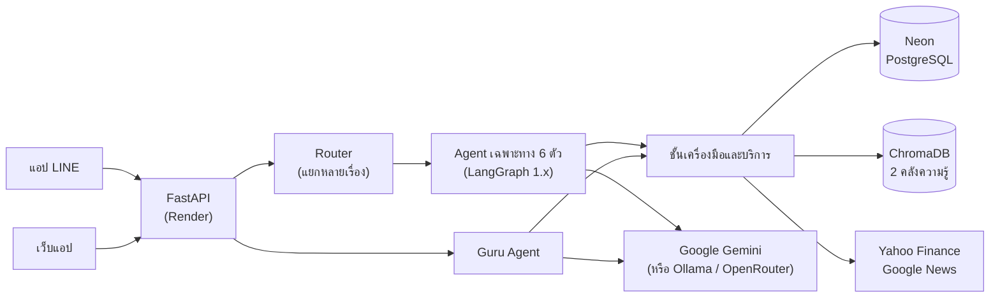

# Personal Finance AI

> ระบบ AI แบบหลาย Agent (Multi-Agent) สำหรับช่วยจัดการการเงินส่วนบุคคล ออกแบบมาเพื่อผู้ใช้ชาวไทย

[](./.github/workflows/ci.yml)
[](https://www.python.org/downloads/)


[](./LICENSE)

## สรุปในหน้าเดียว

| | |
|---|---|
| **สถาปัตยกรรม** | LangGraph แบบ Hub-and-Spoke: Router แยกข้อความที่ถามหลายเรื่องแล้วส่งให้ Agent เฉพาะทาง 6 ตัว และมี Guru Agent แยกต่างหาก |
| **RAG** | ChromaDB 2 คลัง: เอกสารการเงินภาษาไทย 24 ฉบับ (สรรพากร ก.ล.ต. ตลท.) และคลังความรู้ของกูรูการลงทุน |
| **ผลการประเมิน** | Router จำแนกถูก 95.6% (411/430) · คำนวณภาษีถูก 26/26 กรณีตามกฎปี 2569 · ใช้ token น้อยกว่าแบบ Single Agent 3.1 เท่า |
| **คุณภาพโค้ด** | test 3,314 ตัว, coverage 96.6%, mypy strict, pylint, เขียนแบบ TDD ทั้งโปรเจกต์ |
| **การใช้งานจริง** | FastAPI บน Render + Neon Postgres, Google Gemini 3.5 Flash, LINE chatbot, OCR ใบเสร็จและ statement ธนาคาร |

## โปรเจกต์นี้ทำอะไรได้บ้าง

ผู้ช่วยการเงินที่คุยด้วยภาษาไทยได้ ทั้งผ่านเว็บและ LINE

- คำนวณภาษีเงินได้บุคคลธรรมดาตามกฎปี 2569 ครบทุกค่าลดหย่อน และบันทึกค่าลดหย่อนให้เองระหว่างคุย
- บันทึกรายรับรายจ่าย จัดหมวดหมู่ สรุปรายเดือน และตั้งรายการประจำทุกเดือนได้
- ติดตามหนี้ เป้าหมายการเงิน และแผนเก็บเงิน แก้ไขได้จากหน้า Dashboard
- พอร์ตลงทุน: หุ้นไทย หุ้นต่างประเทศ กองทุนรวม (รวม ThaiESG) ทองคำแท่ง และคริปโต พร้อมอัตราแลกเปลี่ยน USD แบบสด
- Watchlist พร้อมแจ้งเตือนข่าวรายวันบนเว็บและ LINE
- ประเมินความเสี่ยงในการลงทุน คะแนนสุขภาพทางการเงิน และคำแนะนำเชิงรุก
- ถามกูรูการลงทุน (บัฟเฟตต์ ดาลิโอ ดร.นิเวศน์ โค้ชหนุ่ม) ทีละคนหรือให้หลายคนตอบเทียบกัน
- อ่านใบเสร็จและ statement ธนาคารจากรูปหรือ PDF แล้วร่างรายการให้กดยืนยัน
- สรุปทุกอย่างเป็นรายงาน ส่งออกเป็น PDF/CSV

## ความสามารถหลัก

### ระบบหลาย Agent (LangGraph)

- **Router Agent** จำแนกเจตนาของคำถาม ถ้าข้อความถามหลายเรื่องจะแยกแล้วส่งให้หลาย Agent ทำงาน ถ้าไม่มั่นใจจะถามกลับพร้อมตัวเลือก
- **Tax Agent** ภาษีเงินได้บุคคลธรรมดา ค่าลดหย่อน การวางแผนลดหย่อน
- **Expense Agent** รายรับ รายจ่าย หนี้ รายการประจำ
- **Asset Monitoring Agent** ราคาหุ้น ข่าว พอร์ต watchlist
- **Planning Agent** เป้าหมายการเงิน แผนเก็บเงิน และตรวจจับสัญญาณทางจิตวิทยาการเงิน
- **Recommendation Agent** คำแนะนำเชิงรุกจากกฎ 10 ข้อ และคะแนนสุขภาพทางการเงิน
- **Report Agent** รายงานรวม ส่งออก PDF/CSV
- **Guru Agent** ตอบในมุมมองของกูรูแต่ละคนจากคลังความรู้ของตัวเอง เครื่องมือที่เขียนข้อมูลจะทำงานหลังผู้ใช้พิมพ์ "ยืนยัน" เท่านั้น

เครื่องมือที่เกี่ยวกับตัวเงินเป็นตัวคำนวณแบบ deterministic ที่ใช้ `Decimal` ทั้งหมด โมเดลภาษาเป็นผู้เรียกใช้เครื่องมือ ไม่ได้คิดตัวเลขเอง

### คลังความรู้ (RAG)

ChromaDB มี 2 collection

- `finance_knowledge` เอกสารการเงินภาษาไทย 24 ฉบับใน [`docs/knowledge_base/`](./docs/knowledge_base/) ครอบคลุมภาษี ค่าลดหย่อน หุ้น กองทุนรวม พันธบัตร DCA การจัดงบ เงินสำรองฉุกเฉิน หนี้ ประกัน ประกันสังคม การเกษียณ และสินทรัพย์ดิจิทัล
- `guru_knowledge` ความรู้ของกูรูแต่ละคน (โปรไฟล์อยู่ใน [`docs/gurus/`](./docs/gurus/))

ใช้ `gemini-embedding-001` ทำเวกเตอร์ และเก็บ cache ไว้ในฐานข้อมูล

### OCR ใบเสร็จและ statement

อัปโหลดรูปใบเสร็จหรือไฟล์ statement ธนาคาร (รูปหรือ PDF) ระบบจะดึงรายการ จำนวนเงิน และร้านค้าออกมา แล้วร่างเป็นรายการรอยืนยัน
(`POST /upload/receipt`, `POST /upload/bank-statement` → `POST /transactions/confirm`)
ตั้งค่าโมเดลสำหรับ OCR แยกจากแชตได้ด้วย `OCR_PROVIDER` และ `OCR_MODEL`

### LINE Chatbot

คุยกับระบบชุดเดียวกันผ่านแอป LINE

- `POST /line/webhook` ตรวจลายเซ็น `X-Line-Signature` (HMAC-SHA256) และตอบรับภายในเวลาที่ LINE กำหนด
- Agent ทำงานเบื้องหลัง แล้วส่งคำตอบกลับผ่าน Push Message API
- บัญชี LINE แต่ละบัญชีผูกกับผู้ใช้และบทสนทนาโดยอัตโนมัติ ประวัติแชตจึงไม่หาย
- ผูกบัญชีกับเว็บ: พิมพ์ `เชื่อมต่อ <userId>` ใน LINE (คัดลอกได้จากการ์ดบนเว็บ) ยกเลิกด้วย `ยกเลิกเชื่อมต่อ` หรือกดปุ่มบนเว็บ
- มีเมนู Quick Reply (บันทึกรายจ่าย / วางแผน / หุ้น / ภาษี)
- แจ้งเตือนข่าวหุ้นใน watchlist ส่งเข้า LINE ด้วย ถ้าผูกบัญชีไว้

### ความปลอดภัยของ API

- ทุก endpoint ต้องส่ง `X-API-Key` ยกเว้น `/health` และ `/line/webhook` (ซึ่งตรวจลายเซ็นของ LINE อยู่แล้ว)
- จำกัดจำนวนคำขอต่อ IP แบบ sliding window ค่าเริ่มต้น 30 ครั้งต่อนาที (ใส่ `0` เพื่อปิด)
- โค้ดอยู่ที่ [`src/finance_ai/core/api_security.py`](./src/finance_ai/core/api_security.py)

## ตัวอย่างการใช้งาน

> **ผู้ใช้:** คำนวณภาษี เงินเดือน 50,000 บาทต่อเดือน ค่าลดหย่อนส่วนตัว 60,000
>
> **Finance AI:** รายได้รวมทั้งปี 600,000 บาท หักค่าใช้จ่าย 50% (สูงสุด 100,000 บาท)
> และค่าลดหย่อนส่วนตัว 60,000 บาท เหลือเงินได้สุทธิ 440,000 บาท ต้องเสียภาษี 21,500 บาท
>
> | รายการ | จำนวนเงิน (บาท) |
> |---|---:|
> | รายได้รวมทั้งปี | 600,000 |
> | ค่าใช้จ่าย (หัก 50% สูงสุด 100,000) | 100,000 |
> | ค่าลดหย่อนส่วนตัว | 60,000 |
> | **เงินได้สุทธิ** | **440,000** |
> | **ภาษีที่ต้องชำระ** | **21,500** |

คำถามอื่นที่ลองได้

- "สรุปค่าใช้จ่ายเดือนนี้" → สรุปรายจ่ายแยกตามหมวด
- "ซื้อ RMF ปีละ 100,000 ได้ลดหย่อนเท่าไหร่" → ตอบโดยอ้างอิงคลังความรู้
- "PTT ราคาเท่าไหร่ แล้วเดือนนี้ใช้เงินไปเท่าไหร่" → Router แยกเป็น 2 เรื่องและส่งให้ 2 Agent
- "ช่วยวางแผนเก็บเงิน 100,000 ใน 1 ปี" → แผนเก็บเงินรายเดือน
- ส่งรูปใบเสร็จ → ร่างรายจ่ายให้กดยืนยัน

## สถาปัตยกรรม



แผนภาพฉบับเต็มและ sequence diagram: [docs/diagrams.md](./docs/diagrams.md)

## ผลการประเมิน

ประเมินระบบ 5 ด้าน รายงานฉบับเต็มอยู่ที่ [docs/evaluation/report/evaluation-report-th.pdf](./docs/evaluation/report/evaluation-report-th.pdf)

| การทดสอบ | คำถาม | ผลลัพธ์ |
|---|---|---|
| สถาปัตยกรรม | แบบใดทำงานสำเร็จมากที่สุด | ระบบจริง (Hub-and-Spoke + แยกหลายเรื่อง) สำเร็จ 92.2% เทียบกับ Single Agent 98.9% แต่ใช้ token น้อยกว่า 3.1 เท่า |
| การแยกหลายเรื่อง | รองรับคำถามที่ต้องใช้หลาย Agent ไหม | Router จำแนกถูก 411/430 ครั้ง (95.6%) คำถามที่ต้องใช้หลาย Agent สำเร็จ 80.6% เทียบกับ 61.1% เมื่อไม่แยก |
| ระดับการคิดของ Router | ใช้ระดับต่ำสุดยังแม่นไหม | แม่นยำพอกัน (95.9% กับ 96.2%) และเร็วขึ้นเกือบเท่าตัว (1.36 กับ 2.59 วินาที) |
| การค้นคืนเอกสาร | โมเดลเวกเตอร์ตัวไหนดีที่สุด | Gemini ได้ nDCG@10 สูงสุด 0.805 ส่วนคำตอบสุดท้ายของ 3 อันดับแรกถูกต้องใกล้เคียงกัน (92.5–94.2%) |
| การคำนวณภาษี | ถูกต้องตามกฎปี 2569 ไหม | ถูก 26/26 กรณี ถ้าไม่ใช้เครื่องมือ โมเดลตอบถูก 7/8 และยังใช้เพดานประกันสังคมแบบเก่า |

รันการประเมินเอง

```bash
make evaluate           # รันการประเมินทั้งหมด
make evaluate-routing   # ความแม่นยำของ Router
make evaluate-rag       # คุณภาพการค้นคืนเอกสาร
make evaluate-gurus     # ประเมิน Guru Agent
make evaluate-compare   # เทียบหลายโมเดล
```

## เริ่มใช้งาน

### สิ่งที่ต้องมี

- Python 3.12 ขึ้นไป
- [uv](https://docs.astral.sh/uv/) สำหรับจัดการ dependency
- Google API key สำหรับ Gemini (ใช้ทั้งแชต OCR และ embedding)
  หรือใช้ Ollama / OpenRouter แทนสำหรับแชต

### ติดตั้ง

```bash
# ดาวน์โหลดโค้ด
git clone https://github.com/pakkaphon-tangtonglang/agenticaiforpersonalfinance.git
cd agenticaiforpersonalfinance

# ติดตั้ง dependency
make install

# สร้างไฟล์ตั้งค่าจากตัวอย่าง แล้วใส่ API key
cp .env.example .env
#   อย่างน้อยต้องตั้ง LLM_PROVIDER (google | ollama | openrouter) และ key ของ provider นั้น
#   Ollama ไม่ต้องใช้ key ถ้ารันในเครื่องที่ http://localhost:11434

# สร้างตารางในฐานข้อมูล (รัน Alembic migration)
make init-db

# (ไม่บังคับ) ใส่ข้อมูลตัวอย่าง เพื่อให้หน้าเว็บมีข้อมูลตั้งแต่เปิดครั้งแรก
uv run python scripts/seed_demo.py

# รัน test เพื่อตรวจว่าติดตั้งครบ
make test
```

### รันแอป

```bash
make dev    # โหมดพัฒนา รีโหลดอัตโนมัติ
make run    # โหมด production
```

- หน้าเว็บ: `http://localhost:8080/`
- เอกสาร API: `http://localhost:8080/docs`

## เรียกใช้จากโค้ด

```python
from finance_ai.agents.llm_factory import create_chat_model
from finance_ai.agents.router_agent import orchestrate_query

result = orchestrate_query(
    "คำนวณภาษี เงินเดือน 1,200,000 บาท มีบุตร 2 คน ซื้อ RMF 100,000",
    chat_model=create_chat_model(),
    user_id="your-user-id",
)

print(result["intent"])    # "tax"
print(result["response"])  # คำตอบภาษาไทยพร้อมรายละเอียดภาษี
```

แบบ streaming

```python
from finance_ai.agents.stream_utils import orchestrate_query_stream

for event in orchestrate_query_stream(
    "สรุปค่าใช้จ่ายเดือนนี้",
    chat_model=create_chat_model(),
    user_id="your-user-id",
):
    if event.event_type == "token":
        print(event.content, end="", flush=True)
```

## โครงสร้างโปรเจกต์

```
agenticaiforpersonalfinance/
├── src/finance_ai/
│   ├── agents/        # Router, Agent เฉพาะทาง, Guru Agent และเครื่องมือของแต่ละ Agent
│   ├── tools/         # ชั้นบริการ: ตรรกะทางธุรกิจ ตัวคำนวณ CRUD
│   ├── rag/           # ChromaDB, embedding, retriever
│   ├── database/      # โมเดล SQLAlchemy และ CRUD
│   ├── line/          # LINE chatbot (webhook, การผูกบัญชี, push)
│   ├── evaluation/    # ชุดประเมินผล
│   ├── core/          # การตั้งค่า log ความปลอดภัยของ API
│   ├── static/        # หน้าเว็บ (HTML/JS/CSS ที่ FastAPI ให้บริการ)
│   └── main.py        # จุดเริ่มต้นของแอป FastAPI
├── tests/             # test (โครงสร้างเหมือน src/)
├── alembic/           # migration ของฐานข้อมูล
├── docs/
│   ├── knowledge_base/  # เอกสารต้นทางของ RAG
│   ├── gurus/           # โปรไฟล์และแหล่งข้อมูลของกูรู
│   ├── evaluation/      # บันทึกและรายงานผลการประเมิน
│   └── diagrams.md      # แผนภาพสถาปัตยกรรม
├── scripts/           # สคริปต์ช่วยงาน (ประเมินผล ข้อมูลตัวอย่าง)
├── render.yaml        # การตั้งค่า deploy บน Render
├── Makefile
└── pyproject.toml
```

## สำหรับนักพัฒนา

### คำสั่ง Make

```bash
make install       # ติดตั้ง dependency และ pre-commit hook
make init-db       # สร้างตารางในฐานข้อมูล
make migrate       # สร้าง migration ใหม่
make dev           # รันโหมดพัฒนา (พอร์ต 8080)
make run           # รันโหมด production
make test          # รัน test พร้อม coverage
make coverage      # สร้างรายงาน coverage แบบ HTML
make format        # จัดรูปแบบโค้ดด้วย black
make lint          # ตรวจโค้ดด้วย pylint
make typecheck     # ตรวจ type ด้วย mypy
make check         # รันทุกการตรวจ
make guru-index    # สร้างคลังความรู้ของกูรู
make clean         # ลบไฟล์ที่สร้างขึ้นระหว่างทำงาน
```

### มาตรฐานโค้ด

- ทุกฟังก์ชันมี type hint และ docstring
- ฟังก์ชันยาวไม่เกิน 20 บรรทัด
- ใช้ `Decimal` กับตัวเงินทุกจุด ไม่ใช้ `float`
- เขียน test ก่อนโค้ด (TDD) coverage มากกว่า 90%
- pylint มากกว่า 9.0 และ mypy ไม่มี error

## โมเดลภาษาที่รองรับ

ตั้งค่าใน `.env`

| Provider | ค่าที่ตั้ง | โมเดล |
|---|---|---|
| Google Gemini (ใช้งานจริง ทั้งแชตและ OCR) | `LLM_PROVIDER=google` | `gemini-3.5-flash` |
| Ollama | `LLM_PROVIDER=ollama` | `minimax-m3` |
| OpenRouter | `LLM_PROVIDER=openrouter` | ตั้งผ่าน `OPENROUTER_MODEL` |

## การ Deploy

คู่มือเต็ม (Render + Neon Postgres, ตัวแปรสภาพแวดล้อม, การแก้ปัญหา) อยู่ที่ [docs/deployment.md](./docs/deployment.md)
การตั้งค่า Render อยู่ใน [`render.yaml`](./render.yaml)

## ร่วมพัฒนา

1. Fork repository
2. สร้าง branch ใหม่ (`git checkout -b feature/ชื่อฟีเจอร์`)
3. Commit การเปลี่ยนแปลง
4. Push ขึ้น branch ของตัวเอง
5. เปิด Pull Request

ทุก PR ต้องผ่าน `make check` (test, coverage มากกว่า 90%, lint, type check)

## สัญญาอนุญาต

ใช้ได้เพื่อ **ส่วนตัวและการศึกษาเท่านั้น** (รายละเอียดใน [LICENSE](./LICENSE))
การใช้เชิงพาณิชย์ต้องได้รับอนุญาตเป็นลายลักษณ์อักษรจากเจ้าของสิทธิก่อน

## แหล่งข้อมูลและเครื่องมือที่ใช้

- จัดการ Agent: [LangGraph](https://github.com/langchain-ai/langgraph)
- โมเดลภาษา: [Google Gemini](https://ai.google.dev/) (หรือ Ollama / OpenRouter)
- ฐานข้อมูลเวกเตอร์: [ChromaDB](https://www.trychroma.com/)
- ข้อมูลตลาด: [yfinance](https://github.com/ranaroussi/yfinance), [SET](https://www.set.or.th/), [AIMC](https://www.aimc.or.th/)
- กฎภาษี: [กรมสรรพากร](https://www.rd.go.th/)

---

**ข้อจำกัดความรับผิดชอบ:** ระบบนี้ให้ข้อมูลเพื่อการศึกษาเท่านั้น ไม่ใช่คำแนะนำทางการเงิน
ควรปรึกษาผู้เชี่ยวชาญก่อนตัดสินใจลงทุน การคำนวณภาษีอ้างอิงกฎหมายภาษีไทยปี 2569 และอาจไม่รวมการเปลี่ยนแปลงหลังจากนั้น
